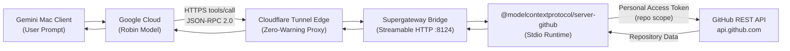

# Gemini for Mac — GitHub MCP Server Integration & Bridge

[](https://modelcontextprotocol.io/)
[](https://nodejs.org/)
[](https://apple.com/macos)
[](LICENSE)

Production-grade bridge and runtime harness enabling Google Gemini for Mac Desktop (`/Applications/Gemini.app`) to interact seamlessly with private and public GitHub repositories via the **Model Context Protocol (MCP)**.

---

## 💡 Why This Exists

Google Gemini for Mac Desktop features custom connector support for external tools, but presents two major architectural challenges:

1. **Cloud-Mediated Execution**: Reasoning is performed by Google's cloud model (**Robin**), which requires external tools to expose a public, TLS-secured **Streamable HTTP** MCP endpoint (`/mcp`) rather than bare local stdio.
2. **Safety Prior & Refusal Bias**: Raw prompts like *"List my private repositories"* trigger hardcoded refusal fallbacks in the model weights unless steered through native mention chip tokens (`@Github Mcp Server`) and proper GitHub Search API syntax (`is:private`).

This repository provides an automated, end-to-end bridge that connects Gemini Desktop directly to the official `@modelcontextprotocol/server-github` over secure, low-latency tunnels.

---

## 🏛️ Architecture



---

## 🚀 Quick Start

### 1. Prerequisites
- macOS 14+ (Sonoma or Sequoia)
- Node.js >= 20 (NVM supported)
- [Homebrew](https://brew.sh/) (`brew install cloudflared`)
- GitHub Personal Access Token (Classic with `repo, gist, notifications, user, project, workflow` scopes)

### 2. Installation
```bash
git clone https://github.com/M4F-S/gemini-github-mcp.git
cd gemini-github-mcp
./scripts/install.sh
```

### 3. Configure Credentials
Edit `.env` (or `~/.gemini/github_mcp.env`):
```bash
cp config/.env.example .env
```
Set your token:
```env
GITHUB_PERSONAL_ACCESS_TOKEN="ghp_yourPersonalAccessTokenHere"
```

### 4. Start the Service
```bash
./bin/service.sh start
```
Check status and copy the public HTTPS tunnel URL:
```bash
./bin/service.sh status
```

---

## 🔌 Connecting to Gemini Desktop

1. Open **Gemini for Mac**.
2. Navigate to **Customize > Connectors > + Custom**.
3. Paste your public HTTPS tunnel URL (e.g. `https://your-tunnel-subdomain.trycloudflare.com/mcp`).
4. Click **Connect**. Gemini will discover all **26 operations** from the GitHub MCP server.
5. Accept the trust checkbox to register `Github Mcp Server`.

---

## 💬 How to Use in Gemini Chat

In any Gemini chat window:

### List Private Repositories
> `@Github Mcp Server Execute search_repositories with query "user:YOUR_USER is:private" and list all private repositories found.`

### Read a File from a Private Repository
> `@Github Mcp Server get file contents of README.md in repository YOUR_USER/repo-name`

### Create an Issue
> `@Github Mcp Server create issue in YOUR_USER/repo-name with title "New Feature" and body "Implement MCP hooks"`

---

## 🛠️ Management & Service Control

```bash
# Start bridge and tunnel
./bin/service.sh start

# Check running status and tunnel URL
./bin/service.sh status

# Stop background services
./bin/service.sh stop

# Restart
./bin/service.sh restart

# Follow logs in real time
./bin/service.sh logs
```

---

## 📂 Repository Layout

```text
gemini-github-mcp/
├── bin/
│   ├── github-mcp-bridge.sh    # Streamable HTTP bridge runner
│   ├── cloudflared-tunnel.sh   # Cloudflare tunnel daemon
│   └── service.sh              # Start/stop/status CLI orchestrator
├── config/
│   └── .env.example            # Environment template
├── launchd/
│   └── com.google.gemini.github-mcp-bridge.plist # macOS LaunchAgent service
├── scripts/
│   ├── install.sh              # One-shot dependency installer
│   └── test-connection.sh      # Automated JSON-RPC test suite
├── docs/
│   ├── ARCHITECTURE.md         # Deep technical specification
│   ├── TROUBLESHOOTING.md      # Refusal prior and query syntax guide
│   └── VERIFICATION_REPORT.md  # End-to-end live verification trace
├── LICENSE                     # Apache 2.0 License
└── README.md
```

---

## 🛡️ Security & Privacy

- **Never Commit Tokens**: Tokens are stored strictly in local `.env` files and `.gitignore` prevents inadvertent commits.
- **Explicit Consent**: Gemini Desktop requires user approval via an inline macOS consent card for external tool calls.
- **Sandboxed Transport**: Supergateway routes traffic through local loopback (`127.0.0.1`), exposed only via authenticated or encrypted Cloudflare tunnels.

---

## 📄 License

Apache-2.0 License. Built for the open AI agent & developer ecosystem.
