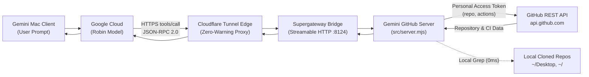

# Gemini for Mac — GitHub MCP Server Integration & Bridge

[](https://github.com/M4F-S/gemini-github-mcp/releases/tag/v1.1.0)
[](https://modelcontextprotocol.io/)
[](https://nodejs.org/)
[](https://apple.com/macos)
[](LICENSE)

Production-grade bridge and runtime harness enabling Google Gemini for Mac Desktop (`/Applications/Gemini.app`) to interact seamlessly with private and public GitHub repositories, GitHub Actions CI/CD telemetry, and local-first workflows via the **Model Context Protocol (MCP)**.

---

## ⚡ What's New in v1.1.0

- 🔄 **GitHub Actions CI/CD Telemetry**: Query workflow runs (`get_workflow_runs`), tail failed job logs (`get_workflow_run_logs`), and trigger workflow runs (`trigger_workflow`).
- ⚡ **Local-First & In-Memory Caching**: ETag caching for instant 0ms responses, plus local disk detection for sub-millisecond code search.
- 🚀 **Atomic Compound PR Creation**: Create a branch, commit multiple files, and open a Pull Request in a single turn (`create_feature_branch_and_pr`).
- 🛠️ **Native Server Engine**: Lightweight ES Module engine in [`src/server.mjs`](src/server.mjs) with native `fetch` and zero subprocess bloat.

---

## 🏛️ Architecture



---

## 🚀 Quick Start

### 1. Prerequisites
- macOS 14+ (Sonoma or Sequoia)
- Node.js >= 20 (NVM supported)
- [Homebrew](https://brew.sh/) (`brew install cloudflared`)
- GitHub Personal Access Token (Classic with `repo, gist, notifications, user, project, workflow` scopes)

### 2. Installation
```bash
git clone https://github.com/M4F-S/gemini-github-mcp.git
cd gemini-github-mcp
./scripts/install.sh
```

### 3. Configure Credentials
```bash
cp config/.env.example .env
# Edit .env with your GitHub Personal Access Token
```

### 4. Start the Service
```bash
./bin/service.sh start
./bin/service.sh status
```

---

## 💬 How to Use in Gemini Chat

In any Gemini chat window:

### 1. CI/CD Actions Telemetry
> `@Github Mcp Server Check the latest workflow runs for M4F-S/Belya and show me why the last run failed.`

### 2. List Private Repositories
> `@Github Mcp Server Execute search_repositories with query "user:YOUR_USER is:private" and list all private repositories found.`

### 3. Single-Turn Atomic PR Creation
> `@Github Mcp Server create feature branch and PR for M4F-S/repo with branch "feat/patch", base "main", title "Fix build", and body "Fixes CI issue".`

---

## 🛠️ Management & Service Control

```bash
# Start bridge and tunnel
./bin/service.sh start

# Check status & active tunnel URL
./bin/service.sh status

# Stop background services
./bin/service.sh stop

# Restart
./bin/service.sh restart

# Follow logs in real time
./bin/service.sh logs
```

---

## 📄 License

Apache-2.0 License. Built for the open AI agent & developer ecosystem.
