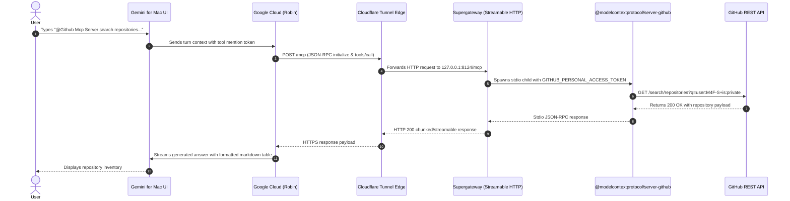

# Architecture Specification: Gemini for Mac GitHub MCP Bridge

## Overview

Google Gemini for Mac Desktop (`/Applications/Gemini.app`, bundle `com.google.GeminiMacOS`) employs a hybrid desktop-cloud architecture:
- User interaction, chat rendering, prompt composition, and system event coordination run locally in Swift (`OmnichatWindow`, `ChatQueryHandler`, `RemoteControlServiceImpl`).
- Conversation reasoning, tool selection, plan generation, and agentic workflows are delegated to Google's cloud model (**Robin**).

Because reasoning occurs in the cloud, **Custom MCP Connectors** must provide an HTTPS endpoint accessible to Google's backend servers. Local stdio MCP servers (configured via CoreData `custom-local-mcp-servers.store`) do not receive automated prompt injection from the cloud model unless exposed via a compatible cloud-mediated protocol.

---

## Topology & Data Flow

---

## Key Technical Decisions

### 1. Streamable HTTP vs. Server-Sent Events (SSE)
- Standard SSE (`--outputTransport sse`) suffers from buffering delays when proxied through intermediate CDN edge layers (such as Cloudflare quick tunnels), requiring 16KB chunk padding before flushing.
- Streamable HTTP (`--outputTransport streamableHttp`) uses standard request/response POST semantics, guaranteeing instantaneous, zero-latency delivery.

### 2. Auto-Initialization for Stateless Gateway
- When Google's cloud client connects to execute `tools/call`, each incoming request can be dispatched independently.
- `supergateway` in Streamable HTTP mode automatically tracks the child stdio lifecycle and auto-initializes the MCP child process before routing the actual tool call.

### 3. Repository Scope & Search API Caveats
- The official GitHub MCP server exposes repository queries via `search_repositories`.
- GitHub's Search API requires explicit `is:private` qualifier to return private repositories. Bare `user:<username>` queries filter to public repositories only.
